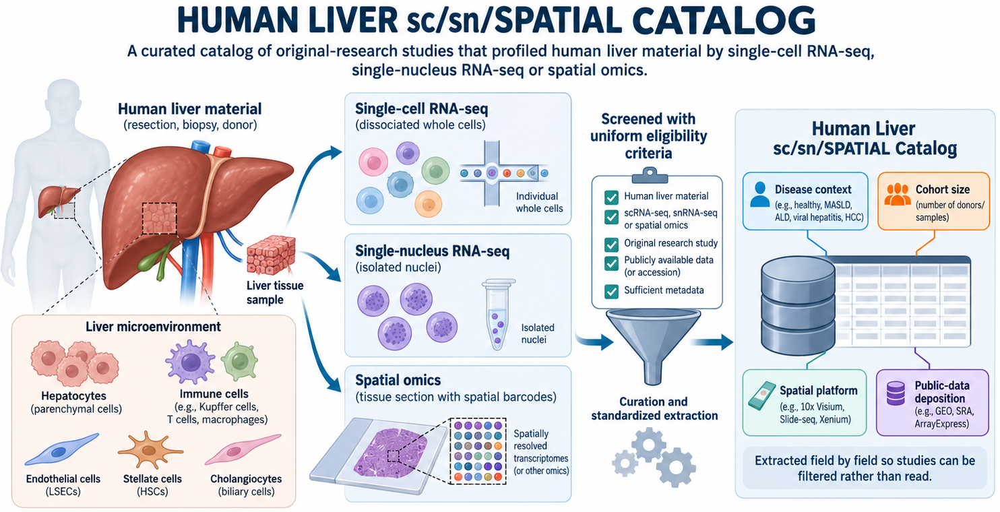
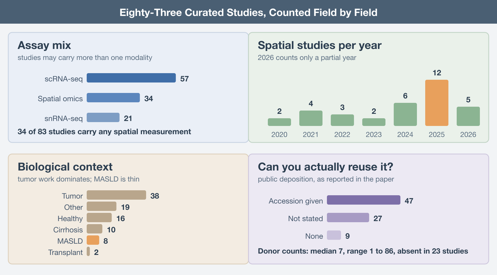

You need a human liver dataset. Preferably MASLD, preferably with spatial information, preferably with enough donors that the comparison you have in mind is not a case report. So you go to PubMed, you type some combination of "liver" and "single-cell" and "spatial", and you get back several hundred hits. Then you start opening abstracts.

Three hours later you have seven candidate papers, four of which turn out to be mouse, two of which used Visium only as a validation panel for an scRNA-seq result, and one of which never says how many donors were profiled. The GEO accession for the good one is buried in a data availability statement that reads "available upon reasonable request".

This is not a search problem. It is a metadata problem, and abstracts are the wrong place to solve it.

## What we built and why

We assembled the [Human Liver sc/sn/Spatial Catalog](https://arbones.github.io/adipo2/liver-atlas.html), a curated knowledge base of original-research studies that profiled human liver material by single-cell RNA sequencing, single-nucleus RNA sequencing, or spatial omics. It currently holds 83 studies, published between 2017 and 2026, spanning peer-reviewed journals and preprint servers. Every entry has been screened against the same eligibility criteria and every entry has had the same fields pulled out of it.

The eligibility rules are deliberately narrow. The material has to be human liver (mouse models and hepatocyte cell lines do not qualify). The qualifying assay has to be sc, sn, or spatial.

The extraction is the point. Each study contributes a structured record rather than a link: the biological context (healthy, tumor, cirrhosis, MASLD, transplant, or other), the number of human individuals profiled, the spatial platform if there was one, the public data status with the accession where it exists, the journal quartile, the study focus, and up to four main results. Each record also carries an evidence flag saying whether the fields were read out of the full text or only from the title and abstract.

## Trends, Gaps, and Bottlenecks Across 83 Studies

Once 83 studies are in the same table, you can ask questions that no individual paper answers. 

**Spatial is still the minority modality.** Thirty-four of the 83 studies carry any spatial measurement at all, against 57 with scRNA-seq and 21 with snRNA-seq. The growth is real; spatial studies went from two to four per year through 2023 to six in 2024 and twelve in 2025, and 2026 is already at five with the year unfinished. But if your plan involves integrating across many spatial liver datasets, the denominator is smaller than the conference talks imply.

**The platform distribution is narrower still.** Among the spatial studies, Visium accounts for 18 and Visium HD for 7. Everything else is a scattering: MERFISH in three studies, GeoMx in two, and one each for Molecular Cartography, in situ sequencing, PhenoCycler, and laser capture. So spatial liver transcriptomics is, in practice, the 10x sequencing-based product line: 25 of the 34 spatial studies are Visium or Visium HD. Classic Visium resolves 55-micron spots, which in liver is several hepatocytes plus whatever else is in the neighborhood, so any analysis that assumes cell-level assignment is leaning on deconvolution to do the work.

**Cohorts are small.** Donor counts are reported in only 60 of the 83 studies; the other 23 either do not state a number or state it in a way that cannot be extracted without guessing. Among those that do report, the median is seven donors. The range runs from one to 86, and the upper tail is thin: Elison and colleagues at 86 donors (Elison, *medRxiv*, 2025) and Li and colleagues at 61 (Li, *Nature Genetics*, 2025) are the outliers, not the norm. A median of seven means most of what looks like a population comparison is a comparison of two handfuls of people.

**Tumor work dominates.** Thirty-eight studies touch tumor biology, against 16 healthy, 10 cirrhosis, 8 MASLD, and 2 transplant. For a disease that affects roughly a third of adults worldwide, eight MASLD studies since 2021 is a startlingly thin evidence base, and five of those eight carry any spatial measurement.

.

## How to actually use it

Start from the constraint that will kill your project, not from the biology. If you need public data, filter on accession first and you drop from 83 to 47 before you read a word. If you need donor-level statistics, sort by donor count and look only at the top of that list, which is short. If you need cell-level spatial resolution rather than spots, the MERFISH and in situ sequencing entries are the whole candidate pool and you can read all of them in an afternoon.

Treat abstract-only records as leads, not as evidence. If one looks right for your question, go get the full text and verify the fields yourself before you build on them.

Do not treat the main results field as a literature review. It is four sentences pulled from a paper, enough to tell you whether the study is worth opening, and no substitute for opening it.

And if a study you know is missing, or a field is wrong, say so. The catalog is maintained rather than published; the whole value of extracting fields by hand is that the mistakes are findable and fixable, which is not true of the search results you would otherwise be relying on.

The underlying problem is not that the literature is too large. It is that the information you need to decide whether a paper is useful to you sits in its methods section and its data availability statement, and neither of those is indexed. Until that changes, somebody has to read the papers. We read these 83.

------------------------------------------------------------------------

## Further Reading

**The catalog:**

- Human Liver sc/sn/Spatial Catalog. Adipofat group, IACS. https://arbones.github.io/adipo2/liver-atlas.html

**Foundational human liver single-cell maps in the catalog:**

- MacParland SA, et al. Single cell RNA sequencing of human liver reveals distinct intrahepatic macrophage populations. *Nature Communications* 2018. https://doi.org/10.1038/s41467-018-06318-7

- Aizarani N, et al. A Human Liver Cell Atlas reveals Heterogeneity and Epithelial Progenitors. *Nature* 2019. https://doi.org/10.1038/s41586-019-1373-2

- Ramachandran P, et al. Resolving the fibrotic niche of human liver cirrhosis at single cell level. *Nature* 2019. https://doi.org/10.1038/s41586-019-1631-3

**Larger and spatially resolved recent entries:**

- Guilliams M, et al. Spatial proteogenomics reveals distinct and evolutionarily-conserved hepatic macrophage niches. *bioRxiv* 2021. https://doi.org/10.1101/2021.10.15.464432

- Andrews TS, et al. Single-cell and spatial transcriptomics characterisation of the immunological landscape in the healthy and PSC human liver. *Journal of Hepatology* 2024. https://doi.org/10.1016/j.jhep.2023.12.023

- Li Z, et al. Spatially resolved multi-omics of human metabolic dysfunction-associated steatotic liver disease. *Nature Genetics* 2025. https://doi.org/10.1038/s41588-025-02407-8

- Yakubovsky O, et al. A spatial atlas of the healthy human liver from live donors. *Nature* 2026. https://doi.org/10.1038/s41586-026-10377-y