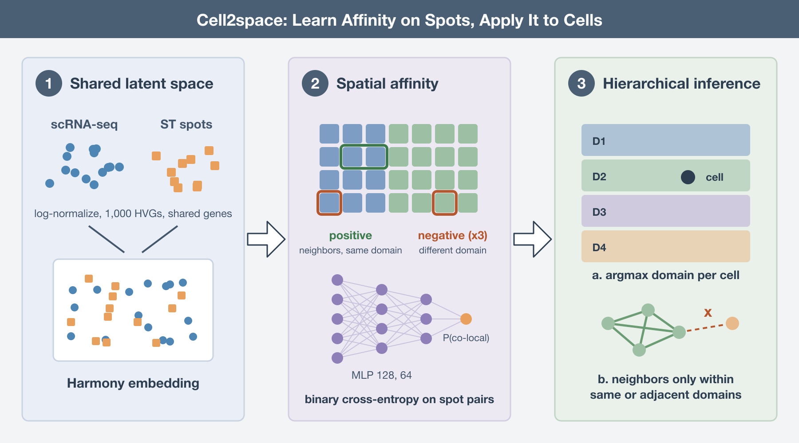
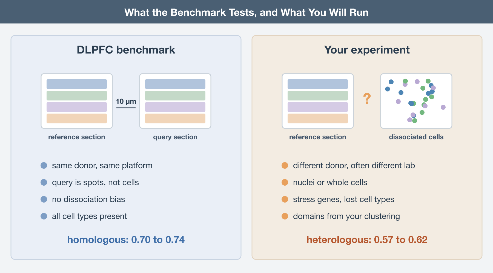

Where a cell sits can matter as much as which genes it expresses. Yet the datasets used to study these questions often reveal only part of the picture. Single-cell RNA sequencing (scRNA-seq) captures expression across the transcriptome but loses the cells’ original locations. Spatial assays preserve location but offer a different compromise: Visium spots combine signals from several cells, while targeted platforms such as STARmap and Xenium measure a limited panel of genes. Combining the two promises a richer view of the tissue, linking molecular detail to spatial context. Many methods pursue that goal. But what does it actually mean when a method says it has “placed” a cell?

Pan, Guan, and Sun at Shandong University approach this question with Cell2space, published in *Briefings in Bioinformatics* (Pan, Briefings in Bioinformatics, 2026). Their central idea is to rethink what a spatial prediction should deliver: which tissue domain a cell belongs to, and which other cells are likely to have been its neighbors. That choice shapes both what the method learns and how its results should be interpreted.

## Coordinates are the wrong target

The existing methods split roughly by what they hand back. **Mapping methods** like Tangram learn a probabilistic assignment of each cell to spots in the reference, so a cell ends up as a distribution over locations (Biancalani, Nature Methods, 2021). **Assignment methods** like CytoSPACE solve an optimization that puts each cell into exactly one spot, under constraints on how many cells each spot can hold (Vahid, Nature Biotechnology, 2023). **Coordinate regression methods** like CeLEry train a network to predict an (x, y) pair directly from expression (Zhang, Nature Communications, 2023). **Embedding methods** like scSpace, STEM, and CellContrast learn a latent space in which expression distance stands in for physical distance, and read neighborhoods off that space (Qian, Nature Communications, 2023; Hao, Communications Biology, 2024; Li, Patterns, 2024).

Coordinate regression is the one that sounds most like what you want and fits the biology least. Two hepatocytes from the same zone, or two layer 4 neurons from opposite ends of a cortical section, have near identical transcriptomes and very different coordinates. A regressor asked to separate them has nothing to work with, so it learns the average and puts both cells in the middle. The result looks precise because it has two decimal places. It isn't.

Cell2space drops the coordinate entirely. It asks two questions that expression can plausibly answer: which spatial domain does this cell belong to, and which other cells are likely to have been its neighbors. The authors say so directly; the method is "not designed for coordinate regression", and when they benchmark coordinate recovery anyway it comes out "competitive but not top-ranked". That is the right thing to concede.

## How the affinity is learned

The machinery is modest. Both modalities are log-normalized, reduced to their top 1,000 highly variable genes in Scanpy, intersected, scaled, and projected into a shared latent space with Harmony (Korsunsky, Nature Methods, 2019). Seurat CCA and scVI were tested as alternatives; Harmony is the default.

The spatial reference then supplies the training signal. A k-nearest-neighbor graph is built over the spots using their physical coordinates. A **positive pair** is two spots that are graph neighbors and share a domain label. A **negative pair** is an anchor spot and a spot from a different domain, at a ratio of three negatives per positive. A small multilayer perceptron, 128 then 64 hidden units with ReLU and batch normalization, takes the concatenated embeddings of a pair and returns a sigmoid probability that the two co-localize. Binary cross-entropy, nothing exotic.

Because both modalities live in the same latent space, the network trained on spot pairs can be pointed at cell pairs, or at cell and spot pairs, without retraining. That is where the hierarchy comes in. Each cell's affinities to all spots are aggregated per domain, corrected for domain size, and the cell takes the domain with the highest score. Cell-to-cell affinities are then computed with the same network, symmetrized, and zeroed for any pair whose predicted domains are neither identical nor adjacent. The coarse answer constrains the fine one.

## What the numbers say

The main benchmark uses the twelve Visium sections of human dorsolateral prefrontal cortex, where each section has manually annotated cortical layers (Maynard, Nature Neuroscience, 2021). Sections come in adjacent pairs. One section serves as the spatial reference; the other has its coordinates withheld and is treated as pseudo-scRNA-seq. Domain assignment averaged 74% accuracy under the stringent criterion and up to 90% under a relaxed one, where a prediction counts as correct if it lands in the true layer or an immediately adjacent layer. Cell2space beat CeLEry, Tangram, STEM, iSORT, CellContrast, and a non-spatial Seurat label transfer on this task.

On a Xenium breast cancer pair, with cell-type annotations as coarse priors, it reached 0.73 domain accuracy and 0.75 cosine similarity between predicted and true neighborhoods at k = 10. On human foreskin, using matched scRNA-seq and Visium from the same study, it reached 0.60 domain accuracy and 0.84 neighborhood similarity, against roughly 0.51 and 0.61 accuracy and 0.75 and 0.79 similarity for STEM and iSORT.

The application that will get quoted is the mouse visual cortex. STARmap measures 1,020 genes in that tissue (Wang, Science, 2018). Mapping whole-transcriptome scRNA-seq from primary visual cortex onto it extends the layer-resolved picture to 38,048 genes, and the authors report 9,764 previously undetectable layer-specific marker genes.

## Read the benchmark before you trust it

Three things in that list deserve a second look.

**The pseudo-cells are spots.** In the DLPFC benchmark, the "single-cell" query is a Visium section from the same donor, on the same platform, cut 10 micrometers from the reference. It carries none of the problems that make real scRNA-seq hard to map: dissociation stress signatures, the systematic loss of fragile or large cell types, nuclei versus whole cells, a different donor, a different chemistry. It is also a mixture of several cells per spot, which is closer to the reference by construction. Seventy-four percent here is a ceiling for the real use case, not an estimate of it.

**Reference mismatch costs a lot.** The robustness analysis on DLPFC section 151674 shows what happens when the reference comes from a different donor. A single homologous slice gives 0.70 accuracy; a single heterologous slice drops to 0.57. Pooling four heterologous slices only recovers to 0.62. Masking 20% of the genes costs a few more points on top. Most of us will not have an adjacent section from the same individual for every scRNA-seq sample. The heterologous numbers are the ones to plan around.

**"Without annotations" means someone else annotated it.** The skin result is presented as reconstructing layered architecture without prior cell annotations. True for the cells. The spatial reference still had to be cut into domains before training, because the positive and negative pairs are defined by domain labels, and that partition came from GraphST clustering into four domains (Long, Nature Communications, 2023). Choose a different clustering, or a different number of domains, and the training signal changes. The method has moved the annotation burden from the cells to the reference, which is a sensible place for it, but it hasn't removed it.

The 9,764 cortical markers need the same care. They are genes whose expression in scRNA-seq correlates with the layer the method assigned each cell to. That is a prediction of spatial pattern, not a measurement of one. Some will be real and some will reflect whatever made a cell look like layer 5 in the 1,000-gene latent space in the first place. A handful of RNAscope or a second targeted panel would separate the two. Without that, they are a candidate list.

## Where the design will hurt

The authors list the limitations themselves, and two of them are structural rather than incidental.

The binary pair construction assumes that tissue is made of domains with edges. Cortex and skin are close to that ideal, which is why they were chosen. Liver zonation is a continuous gradient from portal to central vein. Adipose tissue has no layers at all; its organization is perivascular niches, lobules separated by septa, and crown-like structures that appear around dying adipocytes in some depots and not others. Force any of those into four discrete domains and the positive pairs teach the network a boundary that isn't there. The authors flag gradual transitions, multi-axis organization, and ambiguous boundaries as cases the current scheme may not suit. That list describes most of the tissues I work with.

The second is operational. Preprocessing handles reference and query jointly, so every new scRNA-seq dataset means retraining. The dense implementation scales as the square of the number of cells, and a lightweight mode that restricts each cell to 256 candidate partners brings it down to linear, aimed at about 10\^5 cells. That is workable for one study. It is not a reference atlas you query.

## What to do with this

If you need to place dissociated cells into tissue, decide first what answer you need. If you need a domain label or a likely set of neighbors for cell-cell communication analysis, Cell2space is asking the right question and the code is on GitHub with a tutorial notebook. If you need a coordinate, no method in this space will give you a trustworthy one, and Cell2space is honest enough to say it.

Build the best reference you can, ideally from the same individual, and treat the heterologous numbers as your baseline. Report how the reference domains were defined, because that choice is part of the model. Hold out a section and score your own mapping before you believe it on your own tissue. And validate any "new" spatially restricted gene with an orthogonal measurement before it goes into a figure.

*A method that maps cells to domains and neighborhoods rather than to coordinates is recovering the part of spatial organization that expression actually encodes, and its accuracy is bounded by how well the reference matches the sample and how honestly that reference was partitioned.*

------------------------------------------------------------------------

## Further Reading

**The study:**

- Pan J, Guan Q, Sun D. Stepwise multi-scale reconstruction of cell spatial organization from single-cell RNA sequencing data with Cell2space. *Briefings in Bioinformatics* 2026. https://doi.org/10.1093/bib/bbag531

- Code and tutorial: https://github.com/SDU-Math-SunLab/Cell2space

**Methods it is compared against:**

- Biancalani T, et al. Deep learning and alignment of spatially resolved single-cell transcriptomes with Tangram. *Nature Methods* 2021. https://doi.org/10.1038/s41592-021-01264-7

- Vahid MR, et al. High-resolution alignment of single-cell and spatial transcriptomes with CytoSPACE. *Nature Biotechnology* 2023. https://doi.org/10.1038/s41587-023-01697-9

- Zhang Q, et al. Leveraging spatial transcriptomics data to recover cell locations in single-cell RNA-seq with CeLEry. *Nature Communications* 2023. https://doi.org/10.1038/s41467-023-39895-3

- Qian J, et al. Reconstruction of the cell pseudo-space from single-cell RNA sequencing data with scSpace. *Nature Communications* 2023. https://doi.org/10.1038/s41467-023-38121-4

- Hao M, et al. STEM enables mapping of single-cell and spatial transcriptomics data with transfer learning. *Communications Biology* 2024. https://doi.org/10.1038/s42003-023-05640-1

- Li S, et al. CellContrast: Reconstructing spatial relationships in single-cell RNA sequencing data via deep contrastive learning. *Patterns* 2024. https://doi.org/10.1016/j.patter.2024.101022

**Data and building blocks:**

- Maynard KR, et al. Transcriptome-scale spatial gene expression in the human dorsolateral prefrontal cortex. *Nature Neuroscience* 2021. https://doi.org/10.1038/s41593-020-00787-0

- Wang X, et al. Three-dimensional intact-tissue sequencing of single-cell transcriptional states. *Science* 2018. https://doi.org/10.1126/science.aat5691

- Korsunsky I, et al. Fast, sensitive and accurate integration of single-cell data with Harmony. *Nature Methods* 2019. https://doi.org/10.1038/s41592-019-0619-0

- Long Y, et al. Spatially informed clustering, integration, and deconvolution of spatial transcriptomics with GraphST. *Nature Communications* 2023. https://doi.org/10.1038/s41467-023-36796-3